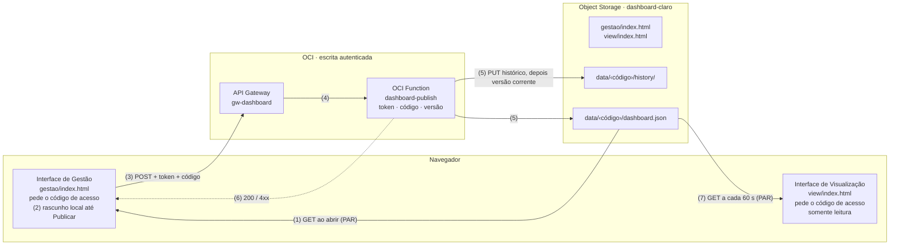
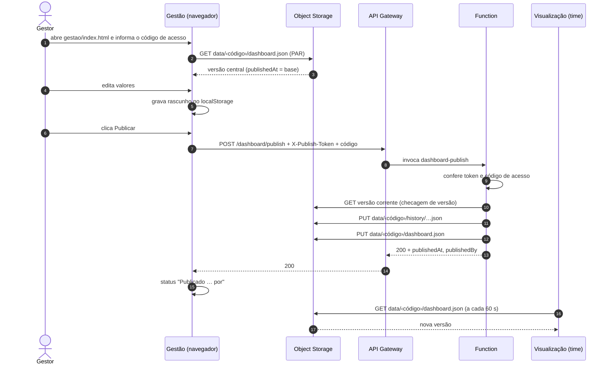

# Fluxo de publicação: da gestão à visualização

**America Movil Brazil · Executive Forecast Dashboard FY27**
Documento de referência do processo de publicação · atualizado em 28/10/2026

O caminho completo de uma alteração: edição na interface de gestão, envio pela API, gravação do JSON no Object Storage e leitura pela interface somente leitura do time, protegida por código de acesso.

| | |
|---|---|
| **Fonte da verdade** | Um único arquivo: `data/<código>/dashboard.json` no bucket `dashboard-claro`. O caminho só é conhecido por quem tem o código. |
| **Quem escreve** | Só a OCI Function `dashboard-publish`, chamada pelo botão Publicar com um token pessoal. |
| **Quem lê** | As duas interfaces, direto do bucket via PAR de leitura, depois que a pessoa informa o código de acesso. A view relê a cada 60 s. |

---

## Visão geral



Caminho de escrita (exige token): 3 → 4 → 5 → 6. Leitura direta do bucket pelo PAR: 1 e 7. As duas páginas HTML também são servidas pelo bucket, pelo mesmo PAR. O nome da pasta dos dados é o código de acesso: sem ele, as páginas não sabem onde buscar o JSON.

### Por que existe a requisição de API?

O navegador consegue **ler** o bucket pelo PAR, mas não deve **gravar** nele diretamente. A API resolve três problemas:

1. **Credencial fora do HTML.** Para gravar no Object Storage é preciso uma credencial OCI. Qualquer credencial colocada na página ficaria visível para quem abrisse o link. A Function grava com a própria identidade (Resource Principal), autorizada pela policy só para o bucket `dashboard-claro`.
2. **Controle de quem publica.** Cada pessoa tem um token próprio, conferido pela Function. O token pode ser revogado sem mexer em código, e cada publicação registra o nome de quem publicou.
3. **Regras antes de gravar.** A Function confere o formato dos dados, impede que uma publicação antiga sobrescreva uma mais nova e guarda uma cópia no histórico antes de trocar a versão corrente.

O API Gateway dá à Function um endereço HTTPS público e cuida do CORS, que é a autorização para uma página servida pelo Object Storage chamar outro domínio.

---

## Etapa por etapa

### 1. Abrir a gestão carrega a versão central
*Gestão · navegador → bucket*

Ao abrir `gestao/index.html`, a página pede o código de acesso (ou usa o que ficou salvo naquele navegador) e faz `GET ../data/<código>/dashboard.json` pelo PAR, sem cache. Código errado resulta em 404, e a página volta para a tela do código. O JSON lido passa a ser o ponto de partida, e a página guarda o seu `publishedAt` como `basePublishedAt`, a versão em que o rascunho se baseia.

- Se houver um rascunho não publicado de uma sessão anterior e a versão central tiver mudado, a página pergunta se deve descartar o rascunho.
- A mesma checagem roda quando a aba volta a ter foco.

### 2. Editar gera um rascunho local
*Gestão · só no navegador*

Cada alteração (valores, workloads, notas, compromissos, Actual+RR, moeda, quarter) atualiza o estado em memória, grava no `localStorage` daquele navegador e marca `updatedAt`. O status muda para **Alterações não publicadas**.

Nada sai do navegador nesta etapa. O time continua vendo a versão anterior.

### 3. Publicar envia o estado completo
*Gestão → API Gateway*

O botão **Publicar** faz um `POST` para o endpoint configurado no ⚙, com o token pessoal no cabeçalho `X-Publish-Token`. O corpo leva o dashboard inteiro, a versão de origem do rascunho e o código de acesso.

```http
POST https://<gateway>.apigateway.sa-saopaulo-1.oci.customer-oci.com/dashboard/publish
Content-Type: application/json
X-Publish-Token: <token pessoal>

{ "force": false,
  "accessCode": "<código de acesso>",
  "state": { ...dashboard completo...,
             "basePublishedAt": "2026-10-26T15:57:12.641Z" } }
```

O endpoint e o token ficam salvos só no navegador de quem configurou. Sem endpoint configurado, ou se a chamada falhar, a página oferece baixar o JSON para upload manual.

### 4. O API Gateway recebe e encaminha
*API Gateway → Function*

- Termina o HTTPS e responde ao pré-voo do CORS (`OPTIONS`), liberando a origem, o método `POST` e os cabeçalhos `Content-Type` e `X-Publish-Token`.
- Encaminha a rota `/dashboard/publish` do deployment `dep-dashboard` para a Function `dashboard-publish`.
- A primeira chamada depois de um período parado pode levar até ~30 s (cold start da Function).

### 5. A Function valida e grava o JSON
*Function → Object Storage*

Na ordem em que acontece:

- **Token:** compara o cabeçalho com a lista `PUBLISH_TOKENS`. Sem correspondência, responde 401 e para.
- **Formato:** exige JSON válido de até 2 MB, com `increments`, `decrements`, `actuals`, `commitments` e `manual`. Fora disso, responde 400.
- **Código de acesso:** compara o `accessCode` enviado com a configuração `ACCESS_CODE`. Se for diferente, responde 403 e a gestão volta para a tela do código. O código também define a pasta onde os dados são gravados.
- **Versão:** lê o JSON corrente. Se o `publishedAt` dele for diferente do `basePublishedAt` enviado, alguém publicou no meio do caminho e a Function responde 409, a menos que `force` seja `true`.
- **Carimbo:** grava `publishedAt` (hora UTC do servidor) e `publishedBy` (nome do token) e remove o `basePublishedAt`.
- **Gravação:** primeiro a cópia em `data/<código>/history/dashboard-fy27-AAAAMMDDTHHMMSSZ.json`, depois a versão corrente `data/<código>/dashboard.json`, com `Cache-Control: no-cache, no-store`.

### 6. A resposta atualiza o status da gestão
*Function → Gestão*

```json
200 OK
{ "message": "Publicado com sucesso.",
  "publishedAt": "2026-10-26T16:01:03.118Z",
  "publishedBy": "marcus",
  "object": "data/<código>/dashboard.json",
  "historyObject": "data/<código>/history/dashboard-fy27-20261026T160103Z.json" }
```

A gestão adota o novo `publishedAt` como versão de origem, limpa a marca de pendência e mostra **Publicado: dd/mm/aaaa hh:mm por marcus**.

### 7. A visualização lê a nova versão
*Visualização · navegador → bucket*

`view/index.html` pede o código de acesso na primeira vez e faz `GET ../data/<código>/dashboard.json` pelo PAR ao abrir, a cada 60 segundos e sempre que a aba volta a ter foco. Com o JSON novo, recalcula GAPs, balance, gráfico e tabelas, e o banner mostra **Dados centrais atualizados: … · por marcus**.

- Se a pessoa trocou moeda ou quarter na tela, essa escolha é mantida nas atualizações seguintes.
- Se a leitura falhar, a página mantém os últimos dados carregados e mostra o aviso em vermelho.
- A página não guarda dados embutidos. Tudo vem do JSON.
- Se o código for trocado, a próxima leitura dá 404: a página limpa os números e volta para a tela do código.

Tempo máximo entre Publicar e o time ver: cerca de 60 s, ou imediato para quem recarregar ou voltar à aba.

---

## Linha do tempo de uma publicação




---

## O arquivo JSON

O JSON publicado fica em `data/<código>/dashboard.json` e é o estado completo do dashboard. Os valores monetários ficam sempre em USD. A conversão para BRL é feita na tela com o `fxRate`.

| Campo | Conteúdo | Quem preenche |
|---|---|---|
| `commitments[4]` | Compromisso de Q1 a Q4, em USD | Gestão |
| `actuals[4]` | Actual+RR de cada quarter | Gestão |
| `increments[]`, `decrements[]` | Workloads: `name`, `tenancy`, `segment`, `flexible`, `completed`, `workloadNote`, `values[4]`, `updatedAt` | Gestão |
| `manual.hw[4]`, `manual.overage[4]` | Desativação de HW e overage estimado (informativo) | Gestão |
| `currency`, `fxRate`, `currentQuarter` | Moeda, câmbio e quarter padrão com que a view abre | Gestão |
| `updatedAt`, `actualUpdatedAt` | Última edição geral e última edição do Actual+RR | Gestão |
| `publishedAt` | Hora da publicação. Também serve como número de versão | Function |
| `publishedBy` | Nome associado ao token que publicou | Function |
| `basePublishedAt` | Versão de origem do rascunho. Só viaja na requisição e não é gravado | Gestão |
| `accessCode` | Código de acesso. Só viaja na requisição, ao lado do `state`, e não é gravado no JSON | Gestão |

---

## Respostas da API e o que aparece na tela

| Código | Significado | Na gestão | O que fazer |
|---|---|---|---|
| **200** | Publicado e gravado no histórico | Publicado: … por \<nome\> | Nada. A view atualiza em até 60 s. |
| **409** | Alguém publicou depois que você abriu a página | Conflito de versão, com nome e hora da versão central | Recarregar e refazer a edição, ou confirmar para sobrescrever. |
| **403** | Código de acesso diferente do configurado na Function (o código foi trocado) | Volta para a tela "Acesso restrito" | Informar o código atual, recebido do responsável. |
| **401** | Token ausente, errado ou revogado | Token recusado | Clicar no ⚙ e colar o token de novo, sem espaços nem o prefixo do nome. |
| **400** | Corpo vazio, JSON inválido ou fora do formato do dashboard | Falha ao publicar | Verificar se a página é a versão atual da gestão. |
| **500** | A Function não conseguiu gravar no bucket | Falha ao publicar | Ver os logs da Function. Em geral é policy ou dynamic group. |
| **502 / 504** | Gateway sem resposta da Function a tempo | Falha ao publicar | Repetir após 30 s. Costuma ser cold start. |

---

## Duas pessoas editando ao mesmo tempo

A checagem de versão evita que uma publicação apague a de outra pessoa sem aviso:

1. Marcus e o backup abrem a gestão. Os dois partem da versão das 10:00.
2. O backup publica às 10:20. A versão central passa a ser a das 10:20.
3. Marcus clica em Publicar às 10:25. O rascunho dele ainda diz "partiu da versão das 10:00", então a Function responde 409.
4. A gestão do Marcus mostra que a versão central é das 10:20, publicada pelo backup. Ele escolhe entre recarregar, para receber a versão nova e refazer a alteração, ou sobrescrever conscientemente.

Mesmo sobrescrevendo, a versão do backup continua em `data/<código>/history/` e também no versionamento do bucket.

---

## Componentes na OCI

| Componente | Nome | Detalhe |
|---|---|---|
| Bucket | `dashboard-claro` | Namespace `grw7zt8i4l5k` · versionamento ativo |
| PAR de leitura | `dashboard-fy27-acesso` | AnyObjectRead, sem listagem · expira em 01/06/2027 |
| Function | `dashboard-app` / `dashboard-publish` | Python 3.11 · shape GENERIC_ARM · imagem em gru.ocir.io |
| API Gateway | `gw-dashboard` / `dep-dashboard` | POST `/dashboard/publish` |
| Identidade da Function | `dg-dashboard-publish` | Dynamic group com todas as functions do compartment |
| Policy | `pol-dashboard-publish` | Function gerencia objetos só em dashboard-claro · Gateway invoca a Function |
| Rede | `vcn-dashboard-functions` | `subnet-dashboard-functions` · rota 0.0.0.0/0 via IGW · ingress TCP 443 |
| Configuração da Function | `PUBLISH_TOKENS` · `ACCESS_CODE` | Tokens no formato nome:token separado por vírgula · código de 20 letras e números |

---

## Código de acesso

O código de acesso impede que só o link baste para ver os números. Ele é o nome da pasta onde os dados ficam no bucket. O PAR não permite listar o bucket, então quem não sabe o código não tem como encontrar o JSON.

| A pessoa tem | Consegue |
|---|---|
| Só o link | Ver a tela "Acesso restrito", sem nenhum número |
| Link + código | Ver os dados na visualização e na gestão |
| Link + código + token | Publicar |

- **Para o time:** no primeiro acesso, a página pede o código. Com "Lembrar neste navegador" marcado, ele não é pedido de novo naquele navegador. O link "Trocar código de acesso", no rodapé, apaga o código salvo.
- **Onde fica:** na configuração `ACCESS_CODE` da Function. Os HTMLs não contêm o código.
- **O que não cobre:** o código é uma senha compartilhada. Quem tiver o código vê os dados. Envie o código por um canal diferente do link.

### Implantação (realizada em 28/10/2026)

1. Código gerado no Cloud Shell: 20 letras e números aleatórios.
2. JSON corrente copiado de `data/dashboard-fy27.json` para `data/<código>/dashboard.json`.
3. Function atualizada (`fn deploy`) e código gravado com `fn config ... ACCESS_CODE`.
4. HTMLs novos de `gestao/` e `view/` publicados no bucket.
5. Teste: código errado retorna 403, e código certo grava em `data/<código>/`.
6. Caminho antigo (`data/dashboard-fy27.json` e `data/history/`) apagado.

### Trocar o código de acesso

Use quando alguém sair do time, quando o código vazar ou periodicamente. O link continua o mesmo. Quem estiver com a página aberta volta para a tela do código em até 60 segundos.

**1. Carregar as variáveis e o contexto do fn** (Cloud Shell)

```bash
export BKT=dashboard-claro
export COMP=$(oci os bucket get -bn $BKT --query 'data."compartment-id"' --raw-output)
export APP=$(oci fn application list -c $COMP --display-name dashboard-app --query 'data[0].id' --raw-output)
export FN=$(oci fn function list --application-id $APP --display-name dashboard-publish --query 'data[0].id' --raw-output)
export GW=$(oci api-gateway gateway list -c $COMP --display-name gw-dashboard --query 'data.items[0].id' --raw-output)
export EP="https://$(oci api-gateway gateway get --gateway-id $GW --query 'data.hostname' --raw-output)/dashboard/publish"
fn use context sa-saopaulo-1
fn update context oracle.compartment-id $COMP
```

**2. Ler o código atual e gerar o novo**

```bash
OLD=$(oci fn function get --function-id $FN | jq -r '.data.config.ACCESS_CODE')
NEW=$(openssl rand -base64 48 | tr -dc 'A-Za-z0-9' | head -c 20)
echo "atual: ${#OLD} caracteres | novo: $NEW"
```

O atual deve ter 20 caracteres. Se aparecer 4 (`null`), a Function está sem código: pare e confira a configuração.

**3. Copiar os dados e o histórico para a pasta nova**

```bash
oci os object get -bn $BKT --name data/$OLD/dashboard.json --file ~/atual.json
oci os object put -bn $BKT --name data/$NEW/dashboard.json --file ~/atual.json \
  --content-type "application/json; charset=utf-8" \
  --cache-control "no-cache, no-store, must-revalidate" --force

rm -rf ~/hist && oci os object bulk-download -bn $BKT --prefix data/$OLD/history/ --download-dir ~/hist
oci os object bulk-upload -bn $BKT --src-dir ~/hist/data/$OLD/history \
  --object-prefix data/$NEW/history/ --content-type "application/json; charset=utf-8"

oci os object head -bn $BKT --name data/$NEW/dashboard.json --query '"content-type"'
```

**4. Gravar o código novo na Function**

```bash
fn config function dashboard-app dashboard-publish ACCESS_CODE "$NEW"

oci fn function get --function-id $FN \
  | jq '{chaves: (.data.config | keys), tamanho_codigo: (.data.config.ACCESS_CODE | length)}'
```

Confira se aparecem `ACCESS_CODE` e `PUBLISH_TOKENS`, com tamanho 20. Use o `fn config`: ele altera só essa chave e mantém os tokens.

**5. Testar: o código antigo deve ser recusado**

```bash
TK=$(grep '^marcus:' ~/dashboard-fy27/tokens.txt | cut -d' ' -f2)   # ou: TK=valor_do_seu_token (sem sinais < >)
jq -c --arg c "$OLD" '{accessCode:$c, state:(. + {basePublishedAt:.publishedAt})}' ~/atual.json > ~/teste.json
curl -s -w " -> %{http_code}\n" -X POST "$EP" -H 'Content-Type: application/json' \
  -H "X-Publish-Token: $TK" -d @$HOME/teste.json
```

- **403** é o esperado: a Function já usa o código novo. Este teste não publica nada.
- **200** significa que a Function ainda aceita o código antigo. Espere alguns segundos, confira o passo 4 e repita.

**6. Apagar a pasta antiga e guardar o código novo**

```bash
oci os object bulk-delete -bn $BKT --prefix data/$OLD/ --force
rm -rf ~/hist ~/atual.json ~/teste.json
echo "$NEW" > ~/dashboard-fy27/codigo-acesso.txt && chmod 600 ~/dashboard-fy27/codigo-acesso.txt
echo "Novo código: $NEW"
```

Guarde o código novo no gerenciador de senhas. O bucket tem versionamento: versões antigas ficam guardadas, mas não podem ser abertas só com o link, porque exigem um identificador interno que o PAR não permite listar.

**7. Distribuir o código novo**

Envie o código por um canal diferente do link. Na próxima abertura, ou em até 60 segundos para quem estiver com a página aberta, cada pessoa vê a tela do código e informa o novo.

---

## Incluir e remover pessoas na publicação

Cada pessoa que publica tem um token próprio. Todos ficam numa única configuração da Function, `PUBLISH_TOKENS`, no formato `nome:token,nome:token`. O nome é o que aparece como "publicado por" na gestão e na visualização.

> **Gravar a configuração substitui a lista inteira.** Se você gravar só o token novo, todos os outros param de funcionar na hora. Os comandos abaixo leem a lista atual e acrescentam ou retiram um nome dela. Nunca grave uma lista vazia: com ela, ninguém consegue publicar. Use sempre o `fn config`, que altera só a chave `PUBLISH_TOKENS` e preserva o `ACCESS_CODE`.

**1. Abrir o Cloud Shell.** No Console, região **Brazil East (São Paulo)**, clique no ícone do Cloud Shell no topo da tela. Quem executa precisa ter permissão para gerenciar Functions no compartment do bucket.

**2. Carregar as variáveis.** Rode a cada sessão nova do Cloud Shell. O comando `echo "$EP"` mostra o endpoint, que você vai entregar à pessoa.

```bash
export COMP=$(oci os bucket get -bn dashboard-claro --query 'data."compartment-id"' --raw-output)
export APP=$(oci fn application list -c $COMP --display-name dashboard-app --query 'data[0].id' --raw-output)
export FN=$(oci fn function list --application-id $APP --display-name dashboard-publish --query 'data[0].id' --raw-output)
export GW=$(oci api-gateway gateway list -c $COMP --display-name gw-dashboard --query 'data.items[0].id' --raw-output)
export EP="https://$(oci api-gateway gateway get --gateway-id $GW --query 'data.hostname' --raw-output)/dashboard/publish"
echo "$EP"
fn use context sa-saopaulo-1
fn update context oracle.compartment-id $COMP
```

Para ver quem já tem acesso:

```bash
oci fn function get --function-id $FN | jq -r '.data.config.PUBLISH_TOKENS' | tr ',' '\n' | cut -d: -f1
```

**3. Cadastrar a pessoa.** Troque `ana` pelo nome da pessoa: letras minúsculas, números, ponto, hífen ou sublinhado, sem espaço.

```bash
NOVO=ana

ATUAL=$(oci fn function get --function-id $FN | jq -r '.data.config.PUBLISH_TOKENS // ""')

if ! [[ "$NOVO" =~ ^[a-z0-9._-]+$ ]]; then
  echo "Nome inválido: use minúsculas, números, ponto, hífen ou sublinhado"
elif echo "$ATUAL" | tr ',' '\n' | cut -d: -f1 | grep -qx "$NOVO"; then
  echo "O nome $NOVO já existe: escolha outro ou remova o antigo antes"
else
  TK=$(openssl rand -hex 32)
  NOVA="${ATUAL:+$ATUAL,}$NOVO:$TK"
  fn config function dashboard-app dashboard-publish PUBLISH_TOKENS "$NOVA"
  echo "Token de $NOVO: $TK"
fi

# Confira: os nomes antigos continuam e o novo aparece no fim
oci fn function get --function-id $FN | jq -r '.data.config.PUBLISH_TOKENS' | tr ',' '\n' | cut -d: -f1
```

O token aparece uma única vez. Não há como recuperá-lo depois, só gerar outro.

**4. Testar o token antes de entregar**

```bash
curl -s -o /dev/null -w "token de $NOVO -> %{http_code}\n" -X POST "$EP" \
  -H 'Content-Type: application/json' -H "X-Publish-Token: $TK" -d '{}'
```

- **400** é o resultado esperado: o token foi aceito e só o corpo vazio foi recusado.
- **401** logo após o cadastro: espere alguns segundos e repita. A configuração nova leva um instante para chegar à Function.

**5. Entregar o acesso.** Envie os itens abaixo, com o token e o código num canal diferente do link (por exemplo, link e endpoint por e-mail, token por mensagem direta):

- A URL da gestão: o link do PAR terminando em `gestao/index.html`.
- O código de acesso, se a pessoa ainda não tiver.
- O endpoint mostrado no passo 2.
- O token mostrado no passo 3.

**6. A pessoa configura e publica.** Abre a URL da gestão, informa o código de acesso, clica no **⚙**, cola o endpoint e depois o token (só o valor, sem o nome). Em seguida faz uma alteração e clica em **Publicar**. O status deve mostrar "Publicado: … por ana", e a visualização passa a mostrar "· por ana". A configuração fica salva só naquele navegador. Em outro computador ou navegador, ela repete o passo do ⚙.

### Remover uma pessoa

Vale na hora, sem redeploy. As publicações antigas dela continuam no histórico, com o nome dela. Carregue as variáveis do passo 2 antes.

```bash
SAIR=ana

NOVA=$(oci fn function get --function-id $FN | jq -r '.data.config.PUBLISH_TOKENS' | tr ',' '\n' | grep -v "^$SAIR:" | paste -sd, -)

echo "$NOVA" | tr ',' '\n' | cut -d: -f1     # confira a lista que vai ficar

[ -n "$NOVA" ] && fn config function dashboard-app dashboard-publish PUBLISH_TOKENS "$NOVA"
```

### Trocar o token de alguém

Para quem perdeu o token ou suspeita que ele vazou: remova o nome com o bloco acima e cadastre de novo pelo passo 3. O token antigo deixa de funcionar no momento da remoção.

---

## Operação do dia a dia

**Ver quem tem acesso de publicação**

```bash
oci fn function get --function-id $FN \
  | jq -r '.data.config.PUBLISH_TOKENS' \
  | tr ',' '\n' | cut -d: -f1
```

Para incluir, remover ou trocar o token de alguém, siga a seção "Incluir e remover pessoas na publicação". Para trocar o código do time, siga "Trocar o código de acesso".

**Atualizar uma das páginas**

```bash
oci os object put -bn dashboard-claro \
  --name view/index.html --file index.html \
  --content-type "text/html; charset=utf-8" --force
```

Sem o `content-type`, o navegador baixa o arquivo em vez de abri-lo. Os dados não são afetados.

**Voltar para uma versão anterior**

```bash
CODE=$(oci fn function get --function-id $FN | jq -r '.data.config.ACCESS_CODE')
oci os object list -bn dashboard-claro \
  --prefix data/$CODE/history/ --query 'data[].name'
oci os object get -bn dashboard-claro \
  --name data/$CODE/history/<arquivo>.json --file ~/v.json
oci os object put -bn dashboard-claro \
  --name data/$CODE/dashboard.json --file ~/v.json \
  --content-type "application/json; charset=utf-8" \
  --cache-control "no-cache, no-store, must-revalidate" --force
```

Troque `<arquivo>` pelo nome listado, sem os sinais `< >`. Quem estiver com a gestão aberta deve recarregar a página antes de publicar de novo.

**Renovar o link antes de 01/06/2027**

```bash
oci os preauth-request create -bn dashboard-claro \
  --name dashboard-fy27-acesso-2027 \
  --access-type AnyObjectRead \
  --bucket-listing-action Deny \
  --time-expires 2028-06-01T00:00:00Z
```

Distribua os novos links e só depois apague o PAR antigo com `oci os preauth-request delete`.

---

## Cuidados

- Quem tem só o link do PAR vê as páginas, mas não os números: a leitura exige o código de acesso, e a escrita exige também o token. Envie link, código e token por canais diferentes do link.
- Troque o código de acesso quando alguém sair do time. Troque o token quando alguém deixar de publicar.
- Rascunhos ficam só no navegador onde foram feitos. Publique antes de trocar de computador.
- Moeda e quarter também são publicados e definem como a view abre por padrão.
- O backup em Excel da gestão continua disponível como cópia extra, independente do bucket.
